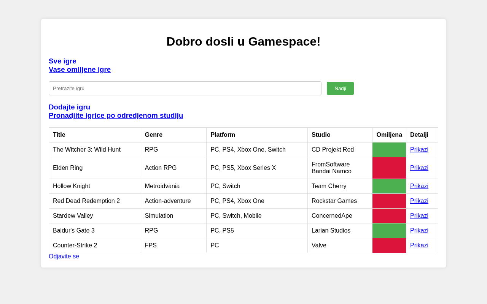
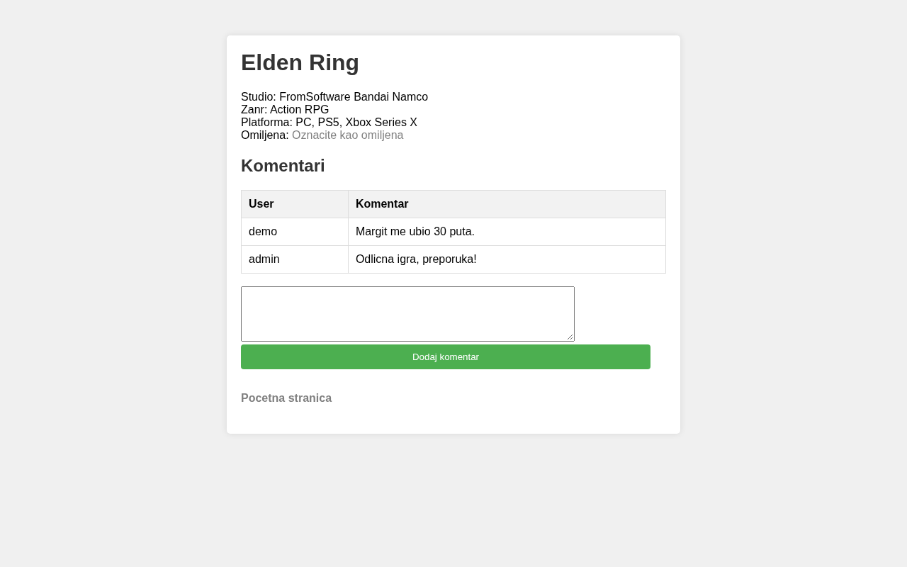

# GameSpace

A small game catalog web app made for the course *Razvoj Informacionih Sistema* (RIS) at the Faculty of Sciences. Users can browse games, mark favorites, leave comments and generate a PDF report of games per studio. Admins can also delete users. The UI is in Serbian.



## Features

- Registration and login (Spring Security, BCrypt passwords, user/admin roles)
- Game list with search, details page, and comments
- Favorite games per user
- Adding new games with their studios
- PDF report of all games from a studio (JasperReports)
- Admin page for deleting users

## Tech

Java 17, Spring Boot 3, Spring Data JPA / Hibernate, Spring Security, JSP + JSTL, JasperReports, MySQL, Maven.

The project has two Maven modules:

- `GameSpace/GameSpaceJPA`: JPA entity classes
- `GameSpace/GameSpaceWeb`: the Spring Boot web app (controllers, services, repositories, JSP pages)

## Running locally

1. Create the database (MySQL 8). The script makes the schema and adds some sample data:
   ```
   mysql -u root -p < GameSpace/database/gamespace.sql
   ```
   Connection settings are in `GameSpaceWeb/src/main/resources/application.properties` (default `root` / `1234`).

2. Install the JPA module, then run the web app from its folder (the JSPs are served from `src/main/webapp`, so run it from there):
   ```
   cd GameSpace/GameSpaceJPA && mvn install
   cd ../GameSpaceWeb && mvn spring-boot:run
   ```

3. Open [http://localhost:8080/Gamespace](http://localhost:8080/Gamespace)

Sample accounts: `admin` / `admin123` (admin) and `demo` / `demo123` (regular user).


